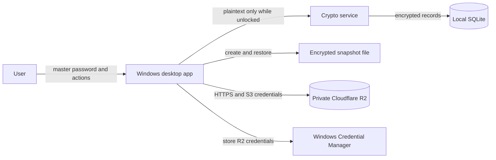

# Architecture

Use this document for the system structure, the [step-by-step data flows](data-flows.md) for runtime behavior, and the [threat-control matrix](threat-control-matrix.md) for the reason each security or reliability part exists.

## 1. Goals and boundaries

Each login entry has two separately encrypted parts:

- `metadata_envelope`: title, username, email address, URL, `d-tags`, and `s-tags`;
- `secret_envelope`: password and notes.

Title is the only mandatory user field. Every other field and both tag collections are optional. `d-tags` and `s-tags` are distinct user-managed string collections; the architecture does not assign hidden meaning to them.

Version 1 has these boundaries:

- one person and one vault;
- one primary writing device at a time;
- complete offline operation;
- optional manual publication of encrypted snapshots to a private Cloudflare R2 bucket;
- user approval before a remote snapshot replaces local data;
- whole-vault replacement, not field-level cloud merging.

Not in version 1: automatic/background sync, simultaneous writers, browser extensions, password autofill, sharing, attachments, a web client, passkeys, remote wipe, and server-side database queries.

## 2. System context



R2 is object storage, not a database replica. It stores immutable encrypted snapshot files plus a small `latest.json` pointer.

Trust boundaries:

1. Plaintext vault content exists only inside the unlocked desktop process.
2. SQLite, snapshot files, R2, logs, and network storage are untrusted for confidentiality.
3. The R2 access key authorizes object operations but cannot decrypt the vault.
4. TLS protects network transport, while vault encryption protects content independently.
5. A compromised Windows process can read secrets while the vault is unlocked.
6. A malicious R2 account can delete, hide, reorder, or replace files; authenticated snapshots and independent backups limit but do not eliminate this risk.

## 3. Desktop design

### Domain

Plain C# entities and use cases such as `CreateEntry`, `UpdateEntry`, `SearchEntries`, `LockVault`, `CheckRemoteSnapshot`, `PublishSnapshot`, and `RestoreSnapshot`. This project does not reference WPF, SQLite, R2, or cryptographic libraries.

### Cryptography

Owns key derivation, key wrapping, encryption envelopes, snapshot authentication, and secure random generation. Callers cannot select nonces, key sizes, or algorithms.

### Infrastructure

Implements:

- local SQLite repositories and migrations;
- consistent snapshot export and staged restore;
- the R2 S3-compatible client;
- Windows Credential Manager integration;
- local rollback copies;
- logging with mandatory redaction.

### Desktop

WPF with MVVM and dependency injection. The UI starts locked, shows remote metadata as untrusted until cryptographically verified, asks before restoring, and automatically locks after inactivity or Windows session lock.

After unlock, the app decrypts entry metadata so the user can search and sort by title, username, email address, URL, `d-tags`, or `s-tags`. Secret envelopes remain encrypted. A password field displays the fixed placeholder `••••••••` regardless of the real password length. Reveal and Copy decrypt only the selected entry's secret envelope for a short operation.

WPF is preferred over WinUI 3 because it is mature, well documented, and sufficient for a personal Windows utility.

## 4. Key hierarchy and encrypted records

```text
master password
    │
    └── Argon2id + random salt ──► password key
                                         │
                                         └── unwraps random vault key

random 256-bit vault key
    │
    ├── HKDF-SHA-256("metadata-v1") ──► metadata key
    ├── HKDF-SHA-256("secrets-v1") ───► secret key
    └── HKDF-SHA-256("manifest-v1") ──► manifest key

metadata key + AES-256-GCM ──► metadata envelopes
secret key + AES-256-GCM ───► secret envelopes
manifest key + HMAC-SHA-256 ─► authenticated snapshot manifest
```

The master password is never stored or uploaded. It derives a password key that unwraps the random vault key. Changing the master password replaces only that wrapping; entry ciphertext does not need to change.

HKDF provides domain separation: metadata, secrets, and manifests never use the same effective key. The exact case-sensitive context strings are part of format version 1 and must not be changed without a format migration.

Each metadata or secret envelope stores:

- format version;
- algorithm identifier;
- fresh random 96-bit nonce;
- ciphertext;
- 128-bit authentication tag;
- authenticated context containing vault ID, entry ID, envelope kind (`metadata` or `secret`), and schema version.

Use .NET's `RandomNumberGenerator` and `AesGcm`. Use a maintained Argon2id package and store its salt, memory, iteration, and parallelism settings in the vault header.

Logical plaintext schemas:

```json
{
  "metadata": {
    "title": "Example Mail",
    "username": "alex",
    "email": "alex@example.test",
    "url": "https://mail.example.test",
    "d-tags": ["personal"],
    "s-tags": ["email"]
  },
  "secret": {
    "password": "example-password",
    "notes": "Example private note"
  }
}
```

These examples show plaintext only to define the model; each object is serialized and encrypted separately. Only `metadata.title` must be non-empty. Only non-secret technical fields remain visible in SQLite:

- random vault and entry IDs;
- metadata and secret envelope versions;
- deletion state if local trash is implemented;
- ciphertext size;
- technical timestamps.

Because password and notes share one secret envelope, revealing or copying either requires temporarily decrypting that selected entry's complete secret payload. The UI exposes only the requested field, clears the temporary payload where practical, and never decrypts secret envelopes for other entries.

## 5. Local SQLite model

Suggested tables:

```text
vault
  id, crypto_version, kdf_parameters, salt,
  wrapped_vault_key, recovery_wrapped_vault_key,
  created_at, updated_at

entry
  id, vault_id, metadata_envelope, secret_envelope,
  metadata_revision, secret_revision, is_deleted,
  created_at, updated_at

remote_state
  vault_id, applied_snapshot_id, applied_generation,
  applied_parent_snapshot_id, last_seen_pointer_etag,
  local_changed_since_snapshot, last_checked_at
```

All local edits use SQLite transactions. `local_changed_since_snapshot` is set in the same transaction as a successful data change. Metadata-only edits replace only `metadata_envelope`; password or notes edits replace only `secret_envelope`. Each replacement uses a fresh nonce and increments that envelope's revision.

Do not place the live SQLite file inside an R2 upload folder or copy it while it may be changing. Snapshot creation uses SQLite's backup mechanism or an application-level export to produce a consistent temporary database.

## 6. Snapshot format

A `.pvault` snapshot is a versioned container containing:

```text
snapshot header
  format version
  vault ID
  Argon2id parameters and salt
  password-wrapped vault key
  optional recovery-wrapped vault key

authenticated internal manifest
  snapshot ID
  parent snapshot ID
  generation
  created time
  source device ID and display name
  user comment
  complete record list and hashes

encrypted records
  entry IDs, metadata envelopes, and secret envelopes
```

The snapshot ID is a random identifier. `parentSnapshotId` identifies the snapshot on which the new snapshot was based. `generation` is convenient for display and basic validation, but lineage is established by IDs, not clocks.

The internal manifest is authenticated with HMAC-SHA-256 using a domain-separated manifest key derived from the vault key with HKDF-SHA-256. It commits to the complete set of records so an attacker cannot silently remove one valid encrypted entry from the container. The Cryptography component owns this derivation; callers never reuse the manifest key for entry encryption.

Snapshot construction:

1. Freeze application writes briefly.
2. Produce a consistent temporary SQLite backup or record export.
3. Build the complete manifest.
4. Authenticate the manifest and verify every included envelope's identity, structure, and ciphertext hash without decrypting secret envelopes.
5. Write to a temporary `.pvault` file.
6. Reopen and validate the temporary file.
7. Atomically move it into the local snapshot staging area.

Never upload a partially written snapshot.

## 7. R2 object layout

Use a dedicated private bucket and random vault ID:

```text
vaults/{vaultId}/latest.json
vaults/{vaultId}/snapshots/{snapshotId}.pvault
```

Snapshot objects are immutable. Upload each one with `If-None-Match: *` so an existing object with the same key is never replaced.

`latest.json` is a small public-to-the-bucket hint:

```json
{
  "schemaVersion": 1,
  "vaultId": "random-vault-id",
  "snapshotId": "random-snapshot-id",
  "parentSnapshotId": "previous-snapshot-id",
  "generation": 12,
  "createdAtUtc": "2026-10-05T19:20:00Z",
  "deviceName": "Home laptop",
  "comment": "Updated from home laptop",
  "size": 42891,
  "sha256": "hex-encoded-file-hash"
}
```

This metadata is not secret and is not trusted before the snapshot is unlocked and its internal manifest matches it. Comments must not contain account names, email addresses, passwords, or other secrets.

For an existing pointer, update `latest.json` with `If-Match: {previousETag}`. For the first pointer, use `If-None-Match: *`. R2 rejects a failed condition with `412 PreconditionFailed`, which the app treats as a publication conflict. Treat an ETag as an opaque value returned by R2, preserve its quoting as required by the client library, and never recompute or interpret it as a content hash.

The SHA-256 value detects transfer errors and identifies exact bytes. It is not a security proof by itself because an attacker able to replace both files can also replace the hash. AES-GCM envelopes and the authenticated internal manifest provide cryptographic authenticity.

## 8. R2 credentials and access

Create an R2 API credential restricted to the dedicated bucket with only the object permissions the workflow requires. Store its access key ID and secret access key in Windows Credential Manager, never in SQLite, source code, configuration committed to Git, logs, or snapshots.

The client accesses the private bucket directly through R2's S3-compatible HTTPS endpoint. There is no Worker and no public bucket URL.

A stolen R2 credential can expose metadata and ciphertext and may permit destructive operations. It does not reveal the master password or vault key. Credential rotation and an independent backup are still required.

## 9. Checking for a remote snapshot

At application startup:

1. Read local `remote_state`.
2. Fetch `latest.json` and its ETag from R2.
3. Validate its size, JSON schema, vault ID, identifier formats, and generation bounds.
4. Compare snapshot and parent IDs, not timestamps.
5. Present one of these states:

| State | Meaning | Action |
|---|---|---|
| Same snapshot ID | Local already represents remote latest | Continue to unlock |
| Remote parent equals local applied snapshot | Remote is a direct successor | Offer download and restore |
| No local vault | New device or recovery | Offer initial download |
| Local has unpublished changes and remote differs | Both sides may contain changes | Stop and report conflict |
| IDs do not form the expected lineage | Divergence, rollback, or metadata damage | Stop and require explicit recovery |
| R2 unavailable | Remote state is unknown | Allow offline unlock with a clear warning |

`createdAtUtc` and `comment` are displayed only as unverified hints. They never decide which snapshot wins.

## 10. Download and restore protocol

When the user approves a remote update:

1. Download the immutable snapshot to a temporary file.
2. Enforce maximum size and safe file paths.
3. Verify byte length and SHA-256 against the untrusted pointer.
4. Ask for the master password.
5. Derive the password key and unwrap the snapshot's vault key.
6. Authenticate the internal manifest and verify every metadata and secret envelope's identity, structure, and ciphertext hash.
7. Verify that internal snapshot ID, parent, generation, and non-secret metadata match the pointer.
8. Restore into a new temporary SQLite database.
9. Open it and run schema and consistency checks.
10. Create a rollback copy of the current local database.
11. Close current database connections.
12. Atomically replace the working database.
13. Update `remote_state` in the restored database.
14. Derive the metadata key, authenticate and decrypt metadata envelopes for the search model, then display the updated vault. Secret envelopes remain ciphertext until a selected-entry secret action.

The app may ask for approval before the password, but it must not replace local data until cryptographic verification succeeds.

## 11. Publish protocol

Publishing is explicit; it never runs automatically:

1. Fetch `latest.json` and remember its ETag.
2. Verify that remote latest still equals the local applied snapshot.
3. If local data has not changed, do nothing.
4. Lock application writes briefly and create a validated snapshot.
5. Set its parent to the current remote snapshot and generation to parent generation plus one.
6. Upload the immutable `.pvault` with `If-None-Match: *`.
7. Update `latest.json` with `If-Match` using the ETag from step 1.
8. If R2 returns `412`, report a conflict and leave the pointer unchanged.
9. If successful, fetch the pointer again and verify its snapshot ID.
10. Mark local state as published.

If step 6 succeeds but step 7 fails, the new snapshot is an unreferenced object. It is safe to retain. Cleanup can remove old unreferenced objects only after a conservative retention period and backup.

## 12. Conflict policy

Version 1 does not merge fields or records from two vault snapshots.

```text
             ┌── snapshot C from Laptop
snapshot B ──┤
             └── snapshot D from Desktop
```

C and D are divergent children. The app preserves both and asks the user to choose a complete snapshot or cancel. It never chooses based on timestamp and never silently overwrites `latest.json`.

The operating rule is:

```text
Fetch before editing
        ↓
Edit on one device
        ↓
Publish after editing
        ↓
Wait for publication before using another device
```

Adding entry-level merge later would require base versions, deletion markers, per-entry conflict UI, and much of the complexity intentionally removed with Worker/D1.

## 13. Backup and recovery

R2 publication is useful remote version storage, but it is not the only backup:

- keep at least one independent encrypted export outside R2;
- retain multiple immutable R2 snapshots;
- test restoration on a clean local database;
- preserve rollback copies for a bounded period;
- document R2 credential rotation;
- explain that losing both the master password and recovery key makes data permanently unreadable.

Old snapshots intentionally remain decryptable with their original key wrapping. A master-password change does not retroactively protect an old snapshot from someone who already has that snapshot and the old password. Full vault-key rotation and history cleanup are separate advanced operations.

## 14. External protocol references

The design relies on Cloudflare R2's documented S3 API compatibility and conditional `PutObject` support:

- [R2 S3 API compatibility](https://developers.cloudflare.com/r2/api/s3/api/)
- [R2 S3 API extensions and conditional operations](https://developers.cloudflare.com/r2/api/s3/extensions/)

Pin and test the chosen .NET S3 client behavior against R2, especially custom `If-Match` and `If-None-Match` headers.
